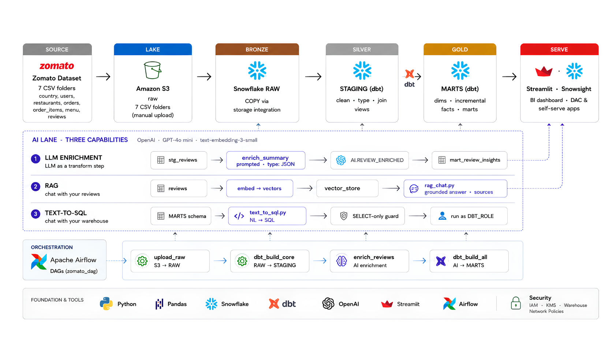

# Zomato AI Data Engineering & GenAI Analytics Platform

An end-to-end **Data Engineering + Generative AI** platform built around a Zomato-style dataset.

The project demonstrates how raw food-delivery data can be transformed into analytics-ready data using **Amazon S3, Snowflake, dbt, Apache Airflow, Python, OpenAI and Streamlit**.

## 🏗️ System Architecture



## 🚀 Key Capabilities

- Automated data ingestion using Apache Airflow
- Raw data storage in Amazon S3
- Snowflake data warehouse
- Medallion architecture: Bronze → Silver → Gold
- dbt transformations and data modeling
- LLM-powered review enrichment
- RAG chatbot for review-based questions
- Natural Language to SQL analytics
- Streamlit analytics dashboard
- Docker-based local development

## 🤖 GenAI Capabilities

### 1. LLM Review Enrichment
Uses OpenAI to analyze customer reviews and generate structured insights.

### 2. RAG Chatbot
Users can ask questions about Zomato reviews and receive grounded answers with relevant sources.

### 3. Text-to-SQL
Users can ask analytical questions in natural language and generate read-only SQL queries against the warehouse.

## 🛠️ Technology Stack

| Layer | Technology |
|---|---|
| Programming | Python, Pandas |
| Storage | Amazon S3 |
| Data Warehouse | Snowflake |
| Transformation | dbt |
| Orchestration | Apache Airflow |
| GenAI | OpenAI |
| RAG | Embeddings + Vector Store |
| Dashboard | Streamlit |
| Containerization | Docker |
| Version Control | Git & GitHub |

## 📂 Project Structure

```text
zomato_pipeline/
├── ai/                 # GenAI, RAG and Text-to-SQL
├── airflow/            # Airflow DAGs
├── data/               # Local/raw datasets
├── docs/               # Project documentation
│   └── architecture.png
├── zomato/             # dbt project
├── docker-compose.yaml
└── README.md

## 🔄 Data Pipeline

The platform follows a modern Medallion Architecture:

```text
Zomato Dataset
      │
      ▼
Amazon S3
(Raw CSV Files)
      │
      ▼
Snowflake RAW
(Bronze Layer)
      │
      ▼
dbt STAGING
(Silver Layer)
      │
      ▼
dbt MARTS
(Gold Layer)
      │
      ▼
Streamlit Analytics

Apache Airflow orchestrates the major pipeline tasks including data ingestion,
dbt transformations and AI enrichment.


🤖 AI & GenAI Architecture
The project contains three major GenAI capabilities.
LLM Review Enrichment
Customer reviews are processed using an LLM to generate structured insights.
Customer Reviews
       ↓
Review Processing
       ↓
OpenAI LLM
       ↓
Structured AI Insights
       ↓
Snowflake
       ↓
Analytics

The enrichment layer can be used for tasks such as review summarization,
sentiment analysis and extracting useful customer insights.


RAG Chatbot
The RAG system allows users to ask questions about the review dataset.
User Question
      ↓
Embedding Generation
      ↓
Vector Search
      ↓
Relevant Reviews
      ↓
LLM
      ↓
Grounded Answer + Sources

The objective is to reduce hallucination by providing the LLM with relevant
retrieved context before generating an answer.


Natural Language to SQL
Users can ask analytical questions using natural language.
Example:
"Which restaurants have the highest average rating?"

The system converts the question into SQL and executes it against the
analytics warehouse using a controlled read-only execution flow.

⚙️ Airflow Orchestration
Apache Airflow is used to orchestrate the data and AI workflows.
The pipeline includes tasks for:
- Uploading raw data to S3
- Loading data into Snowflake
- Running dbt transformations
- Building staging models
- Building analytical marts
- Running AI enrichment
- Preparing data for downstream analytics
Airflow provides scheduling, dependency management and monitoring for the
pipeline.


🗄️ Data Warehouse Design
Snowflake is organized using a layered architecture:
Bronze
Raw data loaded from the source dataset.
Silver
Cleaned and transformed data created using dbt.
Typical transformations include:
- Data type standardization
- Cleaning missing values
- Deduplication
- Joins
- Business logic
Gold
Analytics-ready dimensional and fact models designed for downstream
reporting and GenAI applications.


🚀 Getting Started
Prerequisites
Make sure the following are installed:
- Python 3.x
- Docker Desktop
- Git
- Snowflake account
- AWS account
- OpenAI API access
- dbt
Clone the repository
git clone <YOUR_GITHUB_REPOSITORY_URL>

cd zomato_pipeline

Configure environment variables
Create a .env file locally and configure the required credentials.
Example:
AWS_ACCESS_KEY_ID=your_aws_access_key
AWS_SECRET_ACCESS_KEY=your_aws_secret_key

SNOWFLAKE_ACCOUNT=your_account
SNOWFLAKE_USER=your_user
SNOWFLAKE_PASSWORD=your_password
SNOWFLAKE_DATABASE=your_database
SNOWFLAKE_SCHEMA=your_schema
SNOWFLAKE_WAREHOUSE=your_warehouse

OPENAI_API_KEY=your_openai_api_key

Never commit .env files, API keys, passwords or cloud credentials to GitHub.


🐳 Running with Docker
Start the local services using:
docker compose up

To run the services in the background:
docker compose up -d

Stop the services with:
docker compose down

🧪 dbt
Navigate to the dbt project:
cd zomato

Run dbt models:
dbt run

Run tests:
dbt test

Generate documentation:
dbt docs generate

📊 Analytics
The Streamlit application provides an interactive interface for exploring
the processed Zomato data and AI-generated insights.
The dashboard can be used to analyze:
- Restaurant performance
- Ratings
- Reviews
- Customer insights
- Location-based information
- AI-generated review intelligence


📈 Future Improvements
Planned improvements include:
- Automated cloud deployment
- More advanced RAG retrieval strategies
- Improved Text-to-SQL validation
- Query caching
- Real-time data ingestion
- More comprehensive data quality tests
- Advanced observability and monitoring
- Role-based access control
- Production-grade CI/CD


📌 Project Status
🚧 Active Development
This project is being developed as a portfolio implementation of modern
Data Engineering, Cloud Data Warehousing and Generative AI architecture.


👨‍💻 Author
Manjunath Rathod
Data Engineering | Generative AI | Analytics


